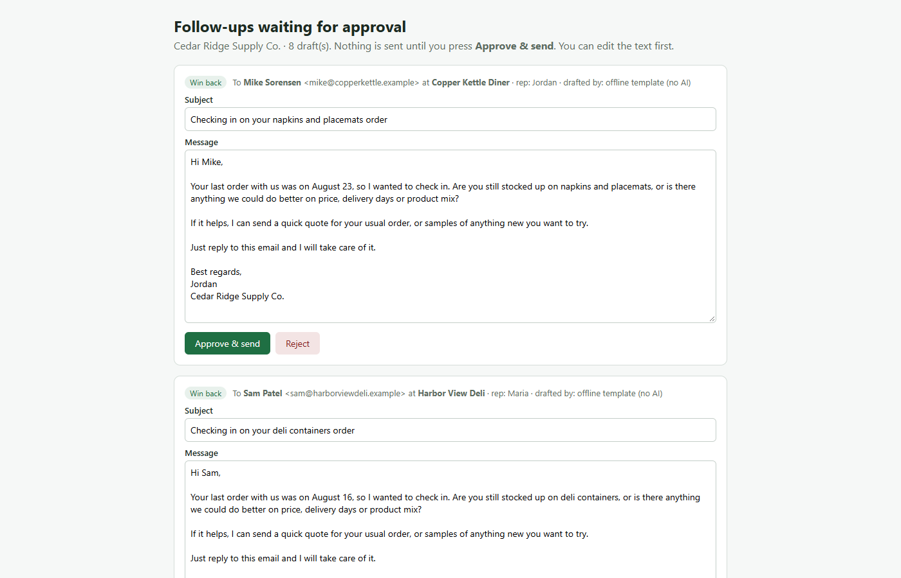
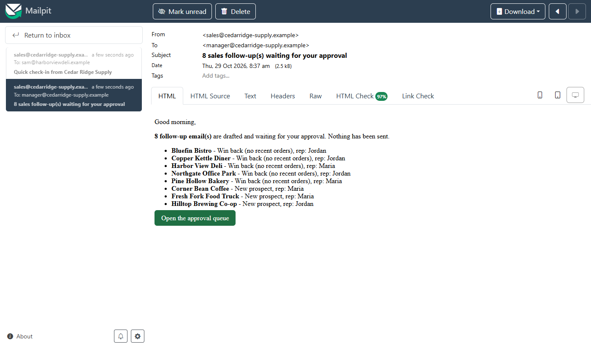
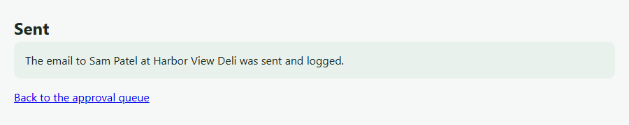
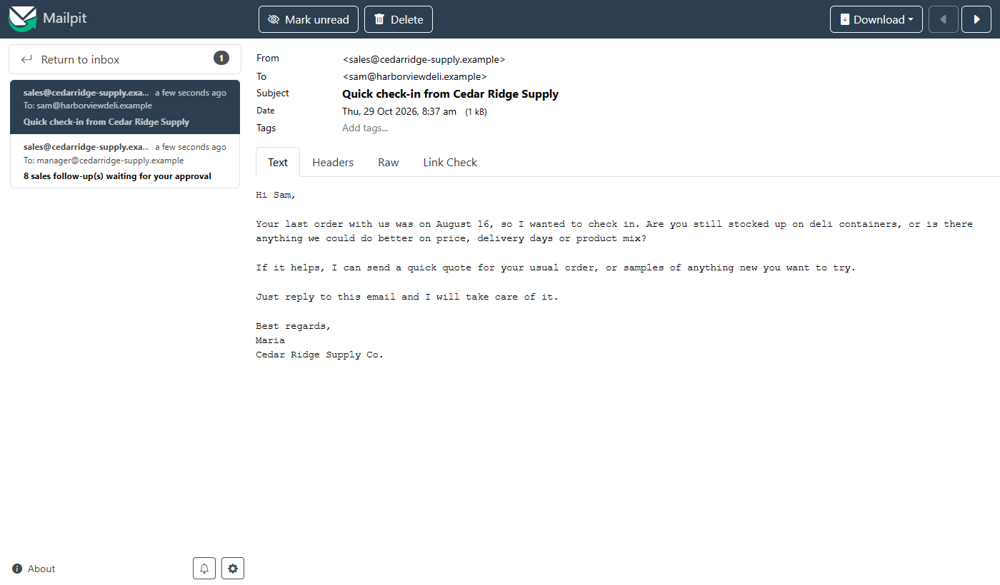
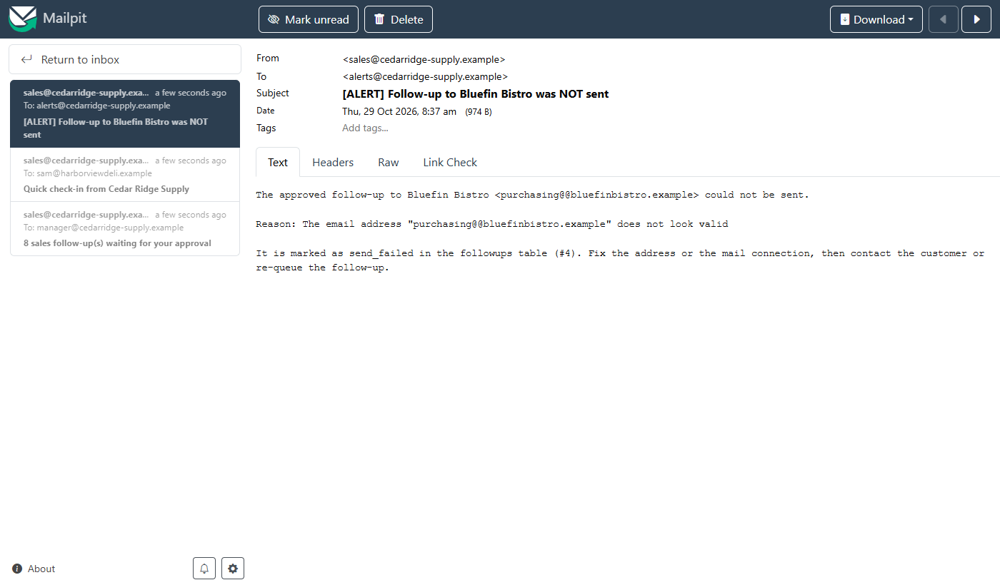
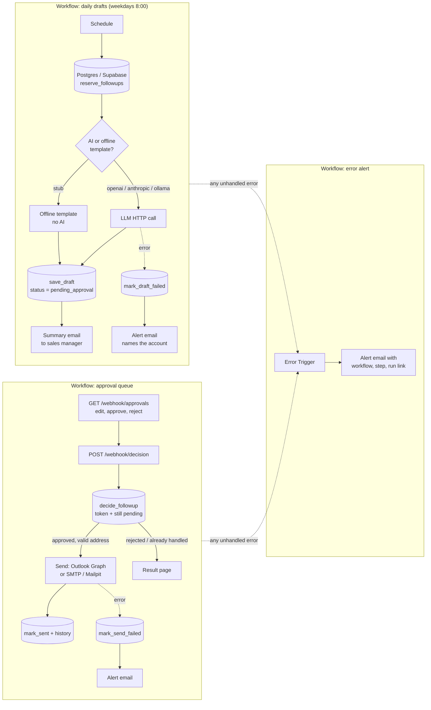
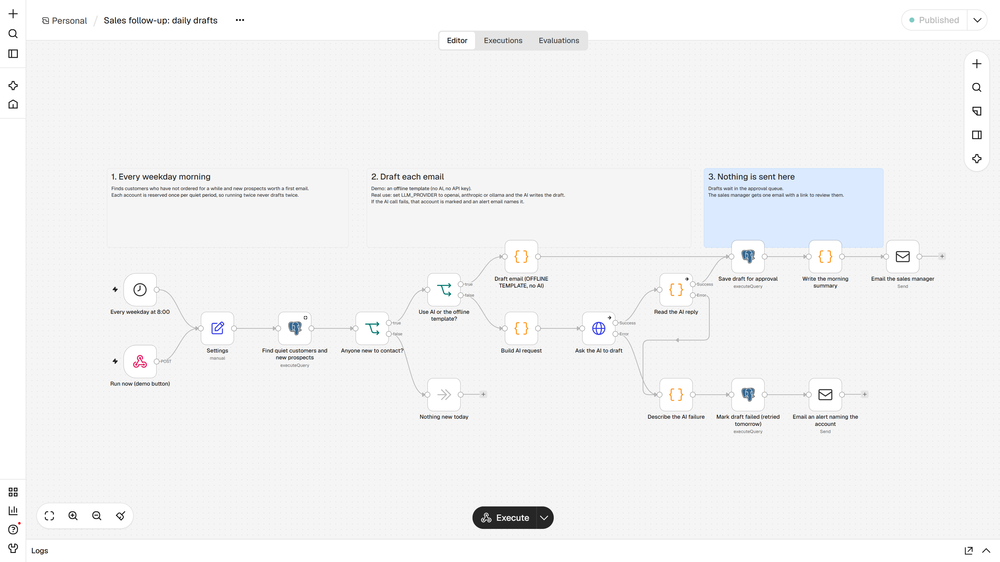
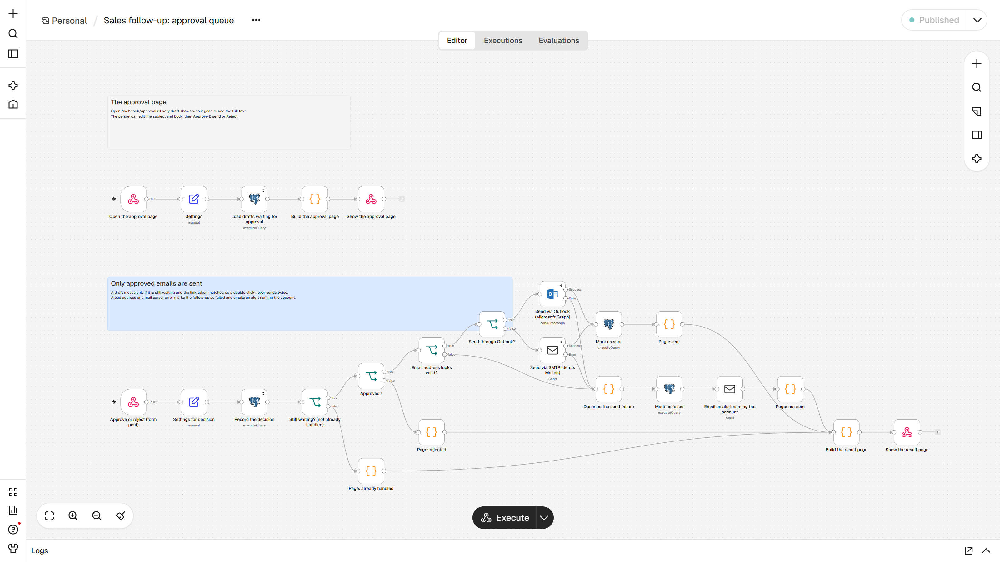

# n8n sales follow-up assistant (with human approval)

> "Automate customer follow-ups, reconnect with inactive accounts, identify new wholesale prospects", without an expensive CRM, and without anything that breaks silently and loses leads.

**Open-source demo.** Everything runs on your own computer with Docker. The customers, orders and company in it are fictional ("Cedar Ridge Supply Co."), and no real email is ever sent: the demo delivers to a fake inbox (Mailpit) that you can open in the browser.



---

## Part 1: for the business owner

### What it does for your team

- **Every weekday at 8:00** it looks at your customer and order list and finds:
  - customers who **have not ordered for a while** (60 days by default), and
  - **new prospects** from your lead list that look like your best customers (same type of business, same region), a few per day.
- For each one it **writes a short, personal follow-up email**, signed by the account's sales rep and mentioning what they usually buy.
- It **does not send anything**. It emails the sales manager one summary: "8 follow-ups are waiting for your approval", with a button to the approval page.
- Every step is **written to a simple history table** (drafted, approved, edited, rejected, sent, failed), so you can always see who was contacted, when and by whom.



### What you approve

You open the approval page (a link in the morning email). For each draft you see who it goes to, the account's rep, and the full text. You can:

- **Edit** the subject or the message, then press **Approve & send**. Only then is the email sent, from your normal sales mailbox (Outlook in real use).
- **Reject** it. It is not sent, and that customer does not get another follow-up until they order again.

Clicking a button twice, or opening an old link, never sends an email twice: the page answers "Already handled".

**Before real use:** in this demo the approval page has **no password**. Anyone who can open its link can approve or reject drafts. It must be put behind a login or a private network first (see "Limits").

| You approve | It is sent | You reject |
|---|---|---|
|  |  | nothing is sent, the decision is logged |

### What happens when something breaks

Nothing fails silently. Every failure ends in an **alert email** that says what failed and what to do:

| What goes wrong | What you see | What happens to the lead |
|---|---|---|
| A customer's email address is mistyped | Warning on the approval page; if approved anyway, an alert naming the customer | Marked "send failed" in the history; nothing is lost |
| The mail server / Outlook refuses the email | Alert naming the customer and the error | Marked "send failed"; you can contact them by hand |
| The AI service fails (wrong or expired API key, service down) | One alert per customer: "Could not draft the follow-up for ..." | Marked "draft failed" and **retried automatically on the next daily run** |
| The customer database is down, or any other unexpected error | Alert with the workflow name, the step that failed and a link to the failed run | Unfinished drafts are picked up again on the next run |



The mistyped address, the AI failure and the database outage are reproduced by the end-to-end test in this repo (see "How to run the tests"). A mail server refusal goes through the same error branch of the send step, but it was not simulated.

### What it is not

- Not a CRM. Your data stays in one small database (Postgres, or Supabase, which is Postgres) with four tables you can open in any spreadsheet-like tool.
- It does not send on its own, ever. A person approves every email.
- It does not search the internet for leads. "New prospects" are the ones you put in the list (trade-show lists, website forms, referrals); the assistant decides who to write to first.

---

## Part 2: technical

### Architecture



Three n8n workflows, exported as JSON in [`workflows/`](workflows/):

| File | What it does |
|---|---|
| `01-error-alert.json` | Error Trigger. The other two workflows point to it (`settings.errorWorkflow`). |
| `02-daily-drafts.json` | Schedule (cron `0 8 * * 1-5`) and a `POST /webhook/run-followups` "run now" webhook. |
| `03-approval-queue.json` | `GET /webhook/approvals` (the page) and `POST /webhook/decision` (the buttons). |




The business rules live in SQL functions in [`db/init/01-schema.sql`](db/init/01-schema.sql), so they are short, testable and the same on Postgres and Supabase:

- `reserve_followups(inactive_days, prospects_per_day)` picks quiet customers and the best-fitting prospects and inserts one `followups` row per account and **cycle** (`UNIQUE (account_id, cycle_key)`). A reconnect's cycle is "quiet since the last order date"; a prospect gets one intro, ever. Running the workflow twice in a day reserves nothing the second time.
- `decide_followup(id, token, decision, subject, body)` moves a draft only if it is still `pending_approval` and the token matches (row lock, `FOR UPDATE`). A double click returns no row, so the send step never runs twice.
- `save_draft`, `mark_draft_failed`, `mark_sent`, `mark_send_failed` change status and append to `activity_log`.

### Quick start

Needs Docker (Docker Desktop on Windows/Mac).

```bash
git clone https://github.com/tales-andre/n8n-sales-followup-agent && cd n8n-sales-followup-agent
docker compose up -d        # first start takes 3-4 minutes: n8n sets up and imports the workflows
curl -X POST http://localhost:5678/webhook/run-followups    # "run now" (on Windows PowerShell: curl.exe)
```

Then open:

- the approval page: <http://localhost:5678/webhook/approvals>
- the fake inbox (summary email, approved emails, alerts): <http://localhost:8025>
- the n8n editor, to see or change the workflows: <http://localhost:5678> (create a local login on first visit)

On start, the n8n container ([`n8n/start.sh`](n8n/start.sh)) creates the database and SMTP credentials from environment variables, imports `workflows/*.json` with the n8n CLI and publishes them. No `.env` is needed for the demo; copy [`.env.example`](.env.example) to `.env` to change settings. The demo defaults in `docker-compose.yml` (the n8n encryption key, the database password) are public placeholder values (`demo-only-...`) that protect nothing: set your own in `.env` before the first start with real customer data or an API key. To start over with fresh sample data: `docker compose down -v`.

### How to run the tests

```bash
python tests/test_workflows.py      # offline, no Docker: workflow JSON, safety rules, schema
python tests/test_e2e.py            # against the running stack (a few minutes)
python tests/test_e2e.py --quick    # same, without the step that restarts n8n
```

Only the Python standard library and the `docker` CLI are used. The end-to-end test resets the sample data and then checks, in order:

1. the daily run drafts exactly the expected accounts (quiet customers + best-fit prospects; skips active customers and the one marked "do not contact"), and only the manager gets an email;
2. a second run the same day drafts nothing new;
3. the approval page lists every draft;
4. an edited + approved draft is sent with the edited text, and the history says "edited before approval";
5. a second click on the same draft sends nothing;
6. a rejected draft sends nothing;
7. a wrong token changes nothing;
8. a mistyped address is not sent and the alert names the customer;
9. with the database stopped, the error workflow emails an alert with the failing step and a link to the run;
10. with the AI provider pointed at a broken endpoint, every draft is marked failed, one alert per account is sent, and after restoring the setting the next run retries and drafts them all.

Last result on the machine that built this repo: all 17 offline checks and all 10 end-to-end steps passed (n8n 2.45.6, Postgres 16, Mailpit 1.27).

The screenshots in `docs/` were taken by [`scripts/screenshots.mjs`](scripts/screenshots.mjs) (`npm install && npm run screenshots`, Playwright driving the locally installed Edge) against this stack, **in offline template mode (`LLM_PROVIDER=stub`)**: the drafts you see were written by the template, not by an AI model.

### How it fails safely

- **Human approval is the only way to send.** The daily workflow has no step that emails a customer; the offline test checks that every path to a "send" node passes through "still waiting", "approved" and "address looks valid".
- **No double sends.** Database constraint per account and cycle, token check and row lock on approval.
- **No silent failures.** Send and AI steps use n8n's error output, so a failure for one account is recorded and alerted without stopping the others. Anything else goes to the error workflow, which emails the workflow name, the failed step, the error and the run link.
- **Retries where they are safe.** A failed draft is retried on the next daily run. A failed send is *not* retried automatically (an email might have been half-delivered); a person decides.
- **Respects "do not contact".** Accounts with `do_not_contact = true` are never selected.
- **API keys stay out of the data.** The LLM key is read from the environment only inside the HTTP header expression. It is not stored in the workflow or the database, and n8n hides `Authorization` / `x-api-key` headers in error details.

### Design decisions and trade-offs

- **n8n + SQL instead of a CRM.** Four tables and six small SQL functions cover the follow-up history. Anyone can open them; Supabase gives a table editor for free.
- **Approval queue in the database, not an n8n "Wait" node.** Drafts survive restarts, can be listed on one page, and can be approved in any order or days later. The trade-off is a small custom HTML page instead of n8n's built-in form.
- **One summary email instead of one email per draft** to the manager: less noise.
- **Offline template by default.** The demo and the tests are deterministic and need no API key. Switching to a real model is one environment variable.
- **Failed sends are not retried automatically.** Safer for a customer-facing email; costs a manual step.
- **Plain-text emails** for follow-ups: they look like a person wrote them.

### Limits (what was not tested or not included)

- **Outlook was NOT connected.** The "Send via Outlook (Microsoft Graph)" node and an empty Outlook credential are in the workflow, but the demo sends through SMTP to Mailpit. No Microsoft 365 tenant was used.
- **QuickBooks was NOT connected.** Orders come from the `orders` table filled by the sample data. See the QuickBooks section below for how it would be fed.
- **No real AI model was called.** The OpenAI-compatible, Anthropic and Ollama request/response code is in the workflow, but only the failure path was exercised (pointed at a local URL that returns 404). Draft quality with a real model was not evaluated.
- **The approval page has no login.** Anyone who can reach the n8n URL can open it. Keep n8n on a private network/VPN, or add Basic Auth / header auth to the two webhooks (an n8n webhook option) before exposing it.
- Replies from customers are not read; a reply goes to the sales mailbox as usual.
- Single n8n instance with its own SQLite; tested on Docker Desktop (Windows), not on a cloud server.

---

## Adapting this to your stack

### Your customer and order data (Postgres or Supabase)

Point `DB_HOST`, `DB_USER`, `DB_PASSWORD`, `DB_NAME` and `DB_SSL=require` (Supabase) in `.env` to your database, then run `db/init/01-schema.sql` there once (Supabase: SQL editor). Load your customers into `accounts` and your order history into `orders` (a CSV import in the Supabase table editor is enough to start). Restart: `docker compose up -d`.

### Connecting Outlook (Microsoft 365) to send approved emails

Not done in this demo. The steps, using what n8n 2.45.6 provides:

1. In the Microsoft Entra admin center (Azure portal) go to **App registrations > New registration**. As redirect URI, paste the "OAuth Redirect URL" shown in the n8n credential window (it ends in `/rest/oauth2-credential/callback`).
2. Under **API permissions** add Microsoft Graph delegated permissions `Mail.Send`, `offline_access` and `User.Read`. Under **Certificates & secrets** create a client secret.
3. In n8n, open **Credentials > Microsoft Outlook (NOT connected in the demo)**, paste the Application (client) ID and the secret, click **Connect my account** and sign in with the sales mailbox.
4. Set `MAIL_PROVIDER=outlook` in `.env` and run `docker compose up -d`. Approved emails now go through the "Send via Outlook (Microsoft Graph)" node and appear in that mailbox's Sent Items.

For sending from several reps' mailboxes without each one signing in, the same n8n node also supports a "Microsoft Entra service principal" (app-only) credential with the application permission `Mail.Send`; ask your Microsoft 365 admin to limit it to the sales mailboxes. Another option is to create **Outlook drafts** instead of sending (the node has a "Draft > Create" operation), so reps press Send in their own Outlook.

### Feeding orders from QuickBooks Online

Not done in this demo. n8n has a QuickBooks Online node (OAuth2) with Customer and Invoice operations. A small extra workflow would run nightly before the 8:00 run:

1. Create an app at the Intuit developer portal (Accounting scope), paste its client ID/secret into an n8n "QuickBooks Online OAuth2" credential and connect your company.
2. **Customer > Get Many** → upsert into `accounts` (company name, contact, primary email, rep).
3. **Invoice > Get Many** (or sales receipts) since the last sync → insert into `orders` (customer, transaction date, total, main line item).

The follow-up logic does not change: it only reads `accounts` and `orders`.

### Using a real AI model for the drafts

Set in `.env` and restart:

```bash
LLM_PROVIDER=anthropic      # or openai (any OpenAI-compatible endpoint) or ollama
LLM_API_KEY=...             # not needed for ollama
LLM_MODEL=                  # anthropic defaults to claude-sonnet-5; required for openai/ollama
```

Use a model id that your provider currently lists (Anthropic's models page, your OpenAI-compatible provider's model list, or `ollama list`). Model ids get retired over time; if the id is wrong, every draft fails, you get one alert per account, and the next run retries.

The prompt (in the "Build AI request" node) asks for under 120 words, signed by the rep, and forbids invented prices, discounts or facts. The drafts still go to the approval page; nothing changes for the person approving.

### Other settings

`INACTIVE_DAYS`, `PROSPECTS_PER_DAY`, `SALES_MANAGER_EMAIL`, `ALERT_EMAIL`, `SALES_FROM_EMAIL`, `COMPANY_NAME`, `TIMEZONE`: see [`.env.example`](.env.example). The email wording for the offline template is in the "Draft email (OFFLINE TEMPLATE, no AI)" node.

## License

MIT, see [LICENSE](LICENSE).
